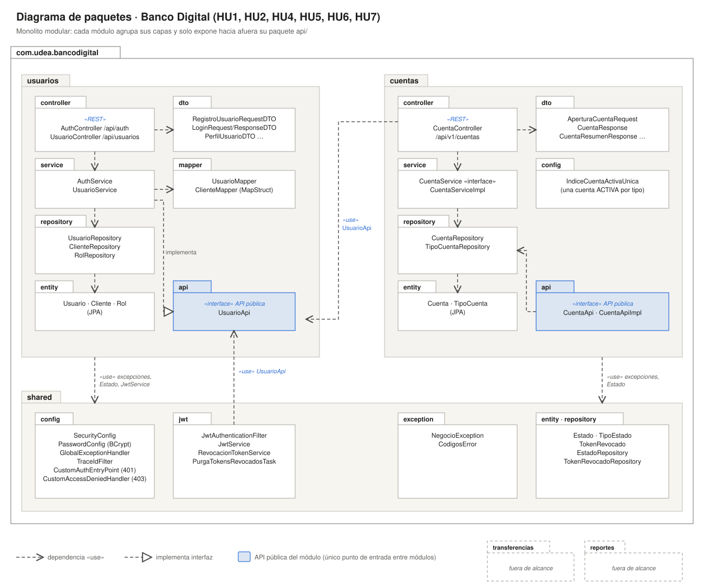
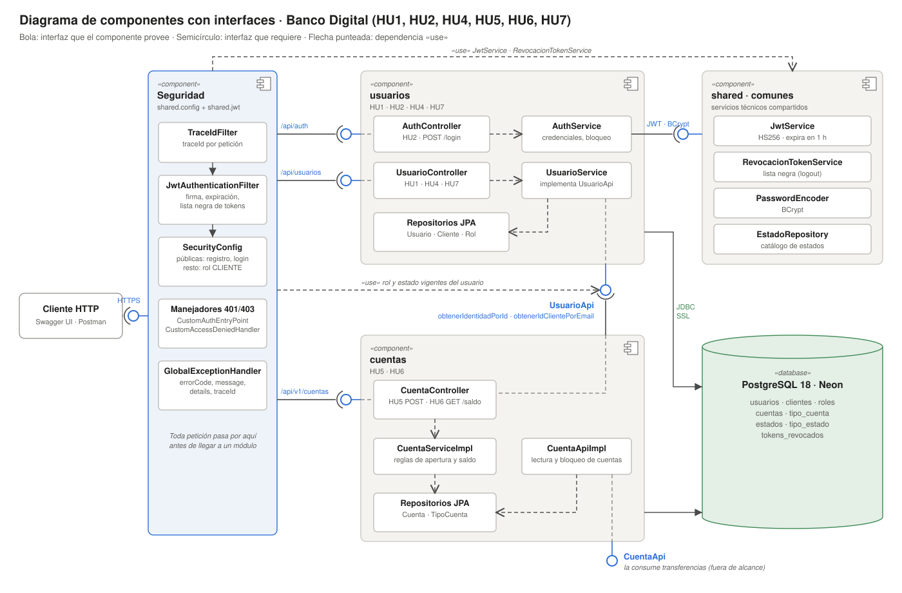
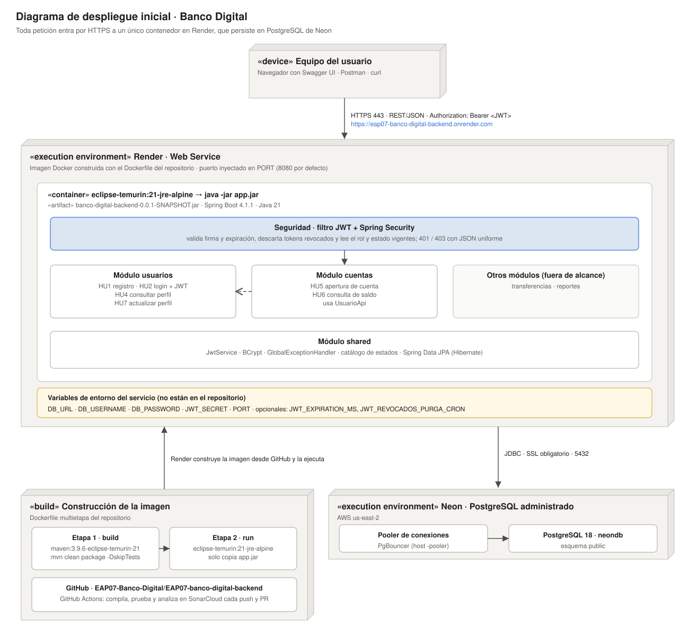

# Arquitectura de Banco Digital (backend)

Estilo preliminar, paquetes, componentes con interfaces y despliegue del backend. El alcance de esta
versión son las historias HU1, HU2, HU4, HU5, HU6 y HU7; los módulos `transferencias` y `reportes`
siguen las mismas reglas, pero no se detallan aquí.

## 1. Estilo arquitectónico: monolito modular

La aplicación es un único servicio Spring Boot (Java 21) dividido en módulos de negocio. Cada módulo es
un paquete bajo `com.udea.bancodigital` que contiene sus propias capas, y solo expone hacia los demás una
interfaz en su paquete `api/`. La decisión y sus alternativas están en el
[ADR-01](../adr/ADR-01-monolito-modular.md).

Reglas de dependencia:

1. Dentro de un módulo: `controller` → `service` → `repository` → `entity`.
2. Entre módulos: solo a través de `api/` (`UsuarioApi`, `CuentaApi`). Nunca se importa el `service` ni
   el `repository` de otro módulo.
3. Las entidades JPA no salen de su módulo; entre módulos viajan *records* (`Identidad`, `CuentaInfo`).
4. Lo transversal (seguridad, JWT, errores, catálogo de estados) vive en `shared`.

## 2. Diagrama de paquetes

| Paquete | Responsabilidad | Elementos representativos |
|---|---|---|
| `usuarios.controller` | Expone registro, login y perfil por REST | `AuthController` (`/api/auth`), `UsuarioController` (`/api/usuarios`) |
| `usuarios.service` | Reglas de registro, credenciales y perfil | `AuthService`, `UsuarioService` |
| `usuarios.api` | Contrato público del módulo | `UsuarioApi` (lo implementa `UsuarioService`) |
| `usuarios.repository` / `entity` | Persistencia de usuarios, clientes y roles | `UsuarioRepository`, `Usuario`, `Cliente`, `Rol` |
| `usuarios.dto` / `mapper` | Contratos de entrada y salida, conversión | `RegistroUsuarioRequestDTO`, `PerfilUsuarioDTO`, `UsuarioMapper` (MapStruct) |
| `cuentas.controller` | Expone apertura y saldo por REST | `CuentaController` (`/api/v1/cuentas`) |
| `cuentas.service` | Reglas de apertura y consulta de saldo | `CuentaService`, `CuentaServiceImpl` |
| `cuentas.api` | Contrato público del módulo | `CuentaApi`, `CuentaApiImpl` |
| `cuentas.repository` / `entity` / `config` | Persistencia de cuentas; índice de una cuenta ACTIVA por tipo | `CuentaRepository`, `Cuenta`, `IndiceCuentaActivaUnica` |
| `shared.config` | Seguridad, errores, trazabilidad | `SecurityConfig`, `GlobalExceptionHandler`, `TraceIdFilter`, `PasswordConfig` |
| `shared.jwt` | Emisión y validación de tokens | `JwtAuthenticationFilter`, `JwtService`, `RevocacionTokenService` |
| `shared.exception` / `entity` / `repository` | Excepción de negocio y catálogos comunes | `NegocioException`, `CodigosError`, `Estado`, `EstadoRepository` |

## 3. Diagrama de componentes con interfaces

| Interfaz | Tipo | La provee | La usan | Operaciones |
|---|---|---|---|---|
| `/api/auth` | REST | `usuarios` (`AuthController`) | Cliente HTTP | `POST /login` (HU2) |
| `/api/usuarios` | REST | `usuarios` (`UsuarioController`) | Cliente HTTP | `POST /registro` (HU1), `GET /me` (HU4), `PUT /me` (HU7) |
| `/api/v1/cuentas` | REST | `cuentas` (`CuentaController`) | Cliente HTTP | `POST /` (HU5), `GET /{numeroCuenta}/saldo` (HU6) |
| `UsuarioApi` | Java | `usuarios` (`UsuarioService`) | `JwtAuthenticationFilter`, `CuentaController` | `obtenerIdentidadPorId`, `obtenerIdClientePorEmail` |
| `CuentaApi` | Java | `cuentas` (`CuentaApiImpl`) | `transferencias` (fuera de alcance) | `obtenerInfoPorNumeroCuenta`, `bloquearPorNumeroCuenta`, `actualizarSaldo` |
| `JwtService` · `PasswordEncoder` | Java | `shared` | `AuthService`, `UsuarioService`, filtro JWT | generar y validar token; cifrar y comparar contraseñas |
| `CuentaService` | Java (interna) | `CuentaServiceImpl` | `CuentaController` | `solicitarAperturaCuenta`, `consultarSaldo` |

Flujo de una petición protegida (por ejemplo, HU6):

1. `TraceIdFilter` asigna un `traceId`.
2. `JwtAuthenticationFilter` valida el token y pide a `UsuarioApi` el correo, el rol y el estado vigentes.
3. `SecurityConfig` exige el rol `CLIENTE`; si no hay sesión responde 401 y si el rol no alcanza, 403.
4. `CuentaController` obtiene el `clienteId` con `UsuarioApi` y llama a `CuentaService`.
5. `CuentaServiceImpl` verifica que la cuenta exista y pertenezca al cliente, y la lee con `CuentaRepository`.
6. Cualquier `NegocioException` sale por `GlobalExceptionHandler` con `{errorCode, message, details, traceId}`.

## 4. Despliegue

- Servicio: https://eap07-banco-digital-backend.onrender.com
  ([Swagger UI](https://eap07-banco-digital-backend.onrender.com/swagger-ui/index.html)).
- Imagen Docker multietapa del [`Dockerfile`](../../Dockerfile); ver el
  [ADR-04](../adr/ADR-04-despliegue-docker-render.md).
- Base de datos PostgreSQL 18 en Neon con SSL; ver el [ADR-03](../adr/ADR-03-postgresql-en-neon.md).

## 5. Decisiones registradas

Ver el [índice de ADR](../adr/README.md).
